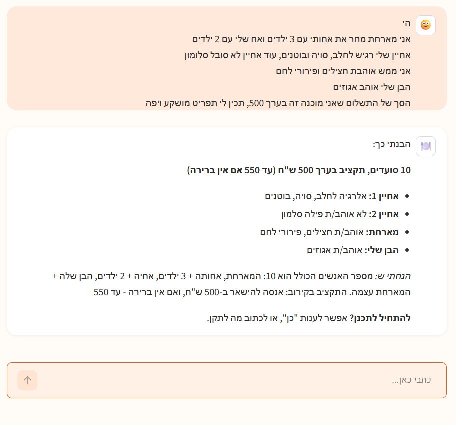
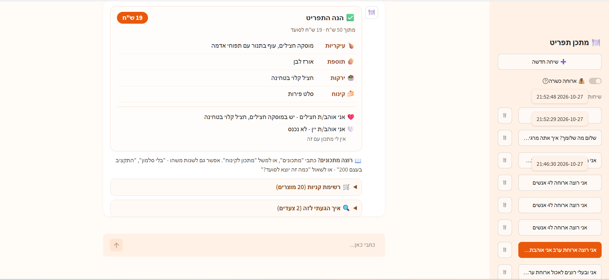

# 🍽️ אג'נט לתכנון תפריט בתקציב

## הסבר קצר

**הבעיה:** כשמארחים ארוחה משפחתית, צריך לאזן בין אילוצים שמתנגשים: לאחד יש אלרגיה לאגוזים, השני צמחוני, השלישית לא אוהבת פטריות, ויש תקציב. כל החלפה של מנה כדי לפתור בעיה אחת עלולה ליצור בעיה אחרת - המנה הזולה יותר מכילה גלוטן, המנה הצמחונית חורגת מהתקציב.

**למה בחרתי בה:** זו בעיה יומיומית שכל מי שמארח מכיר, והיא מתאימה לאג'נט ולא לתוכנית רגילה - אין סדר פעולות קבוע מראש. הצעד הבא תלוי במה שהתגלה בצעד הקודם.

**מה האג'נט עושה:**
1. **מקבל מטרה** - בשפה חופשית ("12 איש, בערך 300 שקל, אחותי טבעונית") או כקובץ: מי מגיע, תקציב, אלרגיות, תזונה, ומה כל אחד אוהב או לא אוהב. "בערך 300" הוא יעד - מותר לחרוג ממנו עד 10%, רק אם אין ברירה.
2. **מחליט בעצמו** איזה כלי להפעיל: לחפש מנות, לחשב עלות, לבדוק את האורחים, לבקש הצעות להחלפה או לאשר תפריט.
3. **בוחן את התוצאה ומשנה כיוון:** חורג מהתקציב - מחליף את המנה שחוסכת הכי הרבה. לאורח אין מה לאכול - מחליף מנה עיקרית.
4. **יודע מתי לעצור:** מצליח רק כשהכלי `finalize_menu` אישר את התפריט, ומפיק רשימת קניות ומתכונים. אם אין פתרון - מדווח למה ומה הכי קרוב שהגיע. גם ההצלחה וגם הוויתור נבדקים בקוד, לא לפי מה שהמודל אומר.

## הדגמה

פלט של ריצות אמיתיות:
- [demo/run_free_text.txt](demo/run_free_text.txt) - מטרה בשפה חופשית ("בערך 150 ש"ח", "אמא שלי מתה על עוגת גבינה"), מהטקסט ועד רשימת קניות ומתכונים. האג'נט מסביר למה עוגת הגבינה לא נכנסה: יש קינוח אחד, והאחות טבעונית.
- [demo/run_friday_dinner.txt](demo/run_friday_dinner.txt) - התפריט הראשון חורג מהתקציב ב-58 ש"ח, והאג'נט מוזיל. `finalize_menu` דוחה את התפריט כי לאורחת שלא אוהבת עגבניות לא נשארה מנה עיקרית, והאג'נט מתקן ומגיע לתפריט הזול ביותר האפשרי.
- [demo/run_impossible_budget.txt](demo/run_impossible_budget.txt) - אין פתרון: האג'נט מוזיל עד שאין עוד מה להוזיל, ומדווח למה. באמצע ה-API של Gemini עמוס, והאג'נט עובר למודל גיבוי וממשיך.

### צילומי מסך מהצ'אט

לפני שמתכננים, האג'נט מציג איך הבין את הבקשה ומחכה לאישור. "בערך 500" הפך ליעד של 500 ותקרה של 550. כאן רואים גם למה האישור חשוב: המודל ספר את המארחת פעמיים (10 סועדים במקום 9) - ואפשר לכתוב לו לתקן לפני שמתחילים:



התפריט שאושר בשיחה אחרת - "ארוחת ערב, עד 50 שקל. אני אוהבת חצילים ויין, שונאת בטטה וקישואים ורגישה לסויה":



עוד מהשיחה של התפריט: [רשימת הקניות](demo/screenshots/4_shopping_list.png) ו[הצעדים של האג'נט](demo/screenshots/5_steps.png) (2 צעדים). וגם: [מסך הפתיחה, ומה קורה בהודעה שלא קשורה לארוחה](demo/screenshots/1_welcome.png), ו[מתכון עם כמויות](demo/screenshots/6_recipe.png) (משיחה אחרת, ל-8 סועדים).

## הוראות הפעלה

דרוש Python 3.10 ומעלה.

```bash
pip install -r requirements.txt
```

**מפתח API:** מעתיקים את `.env.example` לקובץ בשם `.env` ומכניסים מפתח של Gemini (חינמי, מ-https://aistudio.google.com/apikey). המפתח נשמר רק ב-`.env`, שלא עולה ל-Git. אפשר גם OpenAI - ההוראות בתוך `.env.example`.

**הרצה:**

```bash
python agent.py --ask                  # האג'נט שואל מה התוכנית, בשפה חופשית
python agent.py                        # בקשה מוכנה מקובץ (examples/friday_dinner.json)
python -m streamlit run chat.py        # ממשק צ'אט בדפדפן
python -m unittest discover tests      # בדיקות אוטומטיות (בלי אינטרנט ובלי מפתח)
```

---

החלטות התכנון, איך נבדק שהאג'נט צודק, ומגבלות: **[DETAILS.md](DETAILS.md)**
